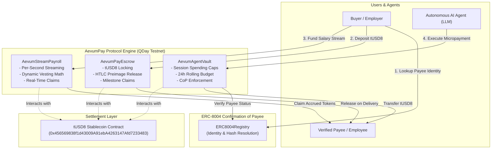

# ⚡ AevumPay Protocol

> **Autonomous AI-Agent & Cross-Border Escrow Protocol with Confirmation of Payee (ERC-8004) and Real-Time Vesting on QDay Aevum Testnet.**

[-00F0FF?style=flat-square)](https://explorer-test.qday.info/)
[](https://soliditylang.org/)
[-10B981?style=flat-square)](https://explorer-test.qday.info/token/0x456569838f1d43009A91ebA4263147Afd7233483)
[](#automated-testing)
[](LICENSE)

---

## 📌 Executive Summary

Traditional cross-border payments, decentralized invoicing, and autonomous agent commerce face three critical vulnerabilities:
1. **Misdirected Payments & Impersonation**: Sending funds to incorrect or malicious addresses without pre-flight identity resolution.
2. **Delivery & Milestone Risk**: Buyers lack trust when paying in advance, and merchants lack guarantees of payment upon milestone completion.
3. **Unbounded Agent Risk**: Autonomous AI agents given private keys can deplete balances due to prompt injection, loop errors, or runaway tool execution.

**AevumPay** solves these vulnerabilities natively on the **QDay Aevum Testnet** by integrating:
- **ERC-8004 Confirmation of Payee (CoP) Registry**: Cryptographically binds canonical identifiers and legal identities to EVM addresses, intercepting unauthorized or spoofed transfers.
- **Enterprise Milestone & Invoice Escrow (`AevumPayEscrow.sol`)**: Supports multi-condition `tUSD8` locking, deadline refunds, dispute arbitration, and atomic **HTLC preimage release**.
- **Continuous Per-Second Streaming Payroll (`AevumStreamPayroll.sol`)**: Enables micro-vesting and real-time salary streaming with pause, claim, and unstreamed token refund mechanisms.
- **Session-Scoped AI Agent Vault (`AevumAgentVault.sol`)**: Authorizes autonomous LLM agents with rolling 24h budget quotas, per-transaction spending limits, and mandatory ERC-8004 payee verification.

---

## 🗺️ Architecture Overview



---

## 🌐 QDay Aevum Testnet Specification

| Parameter | Value |
| :--- | :--- |
| **Network Name** | QDay Aevum Testnet |
| **RPC Endpoint** | `https://rpc-test.qday.info` |
| **WebSocket** | `wss://rpc-test.qday.info` |
| **Chain ID** | `44005` (`0xABE5`) |
| **Native Gas Currency** | `tQDAY` (18 decimals) |
| **Official Stablecoin (tUSD8)** | `0x456569838f1d43009A91ebA4263147Afd7233483` (ERC-20, 6 decimals) |
| **Block Explorer** | [https://explorer-test.qday.info/](https://explorer-test.qday.info/) |
| **Faucet** | [https://faucet.qday.info/en](https://faucet.qday.info/en) |

---

## 📂 Repository Structure

```
aevumpay-protocol/
├── contracts/
│   ├── interfaces/
│   │   ├── IERC20.sol           # Standard ERC20 specification
│   │   └── IERC8004.sol          # ERC-8004 Confirmation of Payee interface
│   ├── mocks/
│   │   └── MockUSD8.sol          # Mock tUSD8 for deterministic testing
│   ├── ERC8004Registry.sol       # Canonical CoP registry & resolution
│   ├── AevumPayEscrow.sol        # Milestone & HTLC invoice escrow
│   ├── AevumStreamPayroll.sol    # Real-time per-second streaming
│   └── AevumAgentVault.sol       # Autonomous AI Agent session vault
├── dapp/
│   ├── index.html                # Responsive Web3 dashboard (Tailwind CSS)
│   └── app.js                    # Web3 provider, wallet & simulation logic
├── docker/
│   ├── Dockerfile                # Production container definition
│   └── docker-compose.yml        # Multi-service composition
├── scripts/
│   ├── compile.py                # solcx Solidity 0.8.24 compiler
│   └── deploy.py                 # Automated QDay Testnet deployment script
├── tests/
│   └── test_contracts.py         # Full unit & invariant test suite
├── requirements.txt              # Python dependencies
└── README.md                     # Comprehensive protocol documentation
```

---

## 🚀 Quickstart & Setup

### Prerequisites
- Python 3.10+ (or Docker)
- MetaMask or Web3-compatible wallet

### 1. Clone & Install Dependencies
```bash
git clone https://github.com/alfredoalvarado53-ui/aevumpay-protocol.git
cd aevumpay-protocol
pip install -r requirements.txt
```

### 2. Compile Smart Contracts
```bash
python scripts/compile.py
```
*Compiles all Solidity 0.8.24 contracts with optimizer runs (200) into `artifacts/`.*

### 3. Run Automated Tests
```bash
python -m unittest tests/test_contracts.py
```
Output:
```text
.....
----------------------------------------------------------------------
Ran 5 tests in 8.235s

OK
```

### 4. Deploy to QDay Aevum Testnet
Set your deployer private key and execute:
```bash
export PRIVATE_KEY=0xYOUR_TESTNET_PRIVATE_KEY
python scripts/deploy.py
```

### 5. Run the Local Web3 dApp
```bash
python -m http.server 8080 --directory dapp
```
Open [http://localhost:8080](http://localhost:8080) in your browser.

---

## 🐳 Running with Docker

Run the entire protocol stack in an isolated container:

```bash
docker compose -f docker/docker-compose.yml up --build
```
Navigate to `http://localhost:8080` to interact with the AevumPay UI.

---

## 🔒 Security & Safety Controls

1. **Reentrancy Protection**: State locks (`nonReentrant`) guard all balance alterations and token transfers across `AevumPayEscrow` and `AevumStreamPayroll`.
2. **Safe ERC-20 Handling**: Low-level call validation handles non-standard ERC-20 return values and prevents silent transfer failures.
3. **Granular Session Limits for AI**: `AevumAgentVault` restricts autonomous LLMs to:
   - A strict single-transaction cap (`perTxLimit`).
   - A rolling 24-hour aggregate budget (`dailyLimit`).
   - Hard expiration dates (`validUntil`).
   - Mandatory ERC-8004 verified recipient enforcement.
4. **HTLC Preimage Verification**: Off-chain or cross-chain triggers can release escrows atomically via `keccak256(preimage)`.

---

## 👥 Hackathon Submission & Team

- **Challenge**: Aevum Builder Challenge #1 (QDay Testnet)
- **Organizer**: PQA Labs / DoraHacks
- **Developer**: Alfredo Alvarado (`alfredoalvarado53-ui`)
- **Recipient Address**: `0xa554a9f6b26e6a418df3623b41e222e18a3b8da6`

---

## 📄 License

This project is licensed under the [MIT License](LICENSE).
